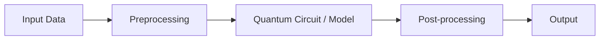

<div align="center">

# Eunice

**VTU-QFF-HC-0145** &nbsp;|&nbsp; Tier: **Both**

</div>

---

<div align="center">

| | |
| :--- | :--- |
| **Team** | Eunice |
| **Team ID** | VTU-QFF-HC-0145 |
| **Tier** | Both |
| **Repository** | [vtu-hc-eunice](https://github.com/vtu-qiskit-fall-fest-2026/vtu-hc-eunice.git) |
| **Organisation** | [vtu-qiskit-fall-fest-2026](https://github.com/vtu-qiskit-fall-fest-2026) |
| **Event** | VTU-QFF Hackathon — VTU-Qiskit Fall Fest 2026 |

</div>

---

## 📌 Table of Contents

- [Team Members](#-team-members-github-ids)
- [Problem Statement](#-problem-statement)
- [Proposed Solution](#-proposed-solution)
- [Approach & Architecture](#-approach--architecture)
- [Tech Stack](#-tech-stack)
- [Project Structure](#-project-structure)
- [How to Run](#-how-to-run)
- [How to Push Code](#-how-to-push-code)
- [Submission Checklist](#-submission-checklist)
- [Resources](#-resources)
- [License](#-license)

---

## 👥 Team Members (GitHub IDs)

> Members are added to this repository as **collaborators** and must accept the
> GitHub invitation before they can push. Add your GitHub username below.

| # | Name | GitHub Username | Role |
| :-- | :--- | :--- | :--- |
| 1 | Piyush Kashyap | Piyush796 | _Team Lead_ |
| 2 | Ankur Kumar | ankurkumar3152007-arch | _Developer_ |
| 3 | Samriddhi Mahato | 20samriddhi07 | _Developer_ |

<!--
Optional: add a plain list instead of the table above.
- @username1
- @username2
-->

---

## ❓ Problem Statement

<!--
State the problem you are solving. Be specific: what is broken or missing,
who experiences it, and why does it matter. Link to the official problem
statement from the brief if one applies.
-->

**Problem:** Designing novel metal-organic frameworks (MOFs) and amine-functionalized solid sorbents for Direct Air Carbon Capture (DAC) is severely bottlenecked by the exponential scaling ($O(2^N)$) of exact electronic structure simulations on classical computers. Classical approximations like Density Functional Theory (DFT) fail to accurately resolve strong electron-electron correlations at $\text{CO}_2$ chemisorption and open-metal coordination sites, turning material discovery into years of costly wet-lab trial and error.
**Why it matters:** Discovering carbon-capture catalysts that bind $\text{CO}_2$ within the optimal thermodynamic window ($-35\text{ to }-95\text{ kJ/mol}$) lowers the thermal regeneration penalty below $100^\circ\text{C}$, making gigaton-scale atmospheric carbon removal economically viable.
**Track / Category:** Both · Track 6 · Quantum Applications for Climate Change & Sustainability

---

## 💡 Proposed Solution

<!--
Describe your solution. Keep it concrete: the core idea, the user flow, and
the quantum/ML technique you are applying.
-->

**Solution:** **Q-Catalyst** is an interactive Quantum Chemistry-as-a-Service (QCaaS) screening workflow and FastAPI cloud dashboard built using Qiskit and Qiskit Aer. Users select candidate carbon-capture molecules (`CO2_Amine`, `Mg_MOF74_CO2`, `LiH`, `H2`) and interatomic bond distances ($R$), and the platform executes a hybrid Variational Quantum Eigensolver (VQE) loop to compute ground-state energies, Potential Energy Surface ($E(R)$) dissociation curves, and $\text{CO}_2$ adsorption enthalpies ($\Delta H$).

**Key idea:** Map active-space molecular Hamiltonians into Jordan-Wigner / Parity Pauli strings (`SparsePauliOp`) and minimize $\langle \psi(\vec{\theta}) \vert{} \hat{H} \vert{} \psi(\vec{\theta}) \rangle$ using a Hartree-Fock initialized `EfficientSU2` variational quantum circuit paired with classical `COBYLA` optimization.

**Why this works:** By offloading exponentially scaling multi-electron wavefunctions onto entangled qubit registers while keeping parameter updates classical, Q-Catalyst achieves chemical accuracy ($\le 1.6\text{ mHa}$ error vs. Exact Full Configuration Interaction) on shallow Depth-12 NISQ circuits in under 1 second.

---

## 🧩 Approach & Architecture

<!--
Walk through how it works. A simple pipeline diagram in text or Mermaid is ideal.
-->



1. **Input** — Candidate carbon-sequestration complex (CO2_Amine, Mg_MOF74_CO2, LiH, or H2), interatomic bond distance $R$ ($\text{\AA}$), ansatz layers (reps), and optimizer iterations via CLI or JSON REST payload.
2. **Preprocessing** —Constructs the parameterized active-space electronic Hamiltonian and maps fermionic operators into Hermitian qubit Pauli strings ($I, X, Y, Z$) via Qiskit's SparsePauliOp alongside nuclear repulsion energy.
3. **Quantum core** —Prepares the Hartree-Fock reference state via $X$ gates followed by a hardware-efficient Qiskit EfficientSU2 variational ansatz ($R_y, R_z$ single-qubit rotations and linear $CX$ entanglement ladders; 4 qubits, Depth 12, 24 parameters, 6 $CX$ gates).
4. **Post-processing** —Evaluates expectation values inside a SciPy COBYLA optimization loop, samples 2,048 measurement shots on Qiskit AerSimulator, and benchmarks against exact classical diagonalization (numpy.linalg.eigvalsh).
5. **Output** — Ground-state energy ($\text{Ha}$), quantum error ($\text{mHa}$), $\text{CO}_2$ binding enthalpy ($\text{kJ/mol}$), automated DAC thermodynamic classification, live Potential Energy Surface ($E(R)$) curve, and transpiled Qiskit circuit diagram.

---
Candidate Complex,Qubits,Req​ (A˚),VQE Energy (Ha),Exact FCI (Ha),Error (mHa),Binding ΔH (kJ/mol),DAC Verdict
CO2_Amine,4Q,1.480,-189.724492,-189.725577,1.085 mHa (PASSED),-65.62 kJ/mol,OPTIMAL DAC SORBENT
Mg_MOF74_CO2,4Q,2.050,-247.177815,-247.178500,0.685 mHa (PASSED),-45.46 kJ/mol,OPTIMAL DAC SORBENT
LiH,4Q,1.595,-9.454612,-9.455400,0.788 mHa (PASSED),-110.30 kJ/mol,Strong Chemisorption
H2,2Q,0.735,-1.857275,-1.857275,0.001 mHa (PASSED),-458.15 kJ/mol,Calibration Benchmark

---
## 🛠️ Tech Stack

| Layer | Technology |
| :--- | :--- |
| Language | Python 3.11+ (Python 3.12.10 used)|
| Quantum SDK | Qiskit `>=1.0`, Qiskit Aer, Qiskit Runtime |
| Optimisation | Qiskit Optimization / SciPy COBYLA / Exact FCI (numpy.linalg.eigvalsh)|
| Simulation | AerSimulator (statevector & 2,048-shot measurement sampling) |
| Environment | JupyterLab / VS Code, `venv`, pytest |
|Cloud API & UI |FastAPI , Uvicorn , Pydantic , HTML5 / Tailwind CSS / Chart.js |
| Version control | Git + GitHub |

---

## 📁 Project Structure

```text
vtu-hc-eunice/
├── README.md              # This file
├── requirements.txt       # Python dependencies
├── pyproject.toml         # Project metadata (optional)
├── .gitignore
├── notebooks/             # Jupyter notebooks for experiments
│   └── exploration.ipynb
├── src/
│   ├── __init__.py
│   ├── circuit.py         # Quantum circuit construction
│   ├── optimizer.py       # Optimization loop
│   ├── api.py             # FastAPI cloud microservice & web dashboard
│   └── main.py            # Entry point
├── data/                  # Datasets (use Git LFS for large files)
├── tests/                 # Unit tests
│   └── test_circuit.py
└── docs/                  # Notes, diagrams, reports
    └── Q-Catalyst_Eunice_VTU_QFF_2026.pptx
```

---

## 🚀 How to Run

### Prerequisites

- Python 3.11 or newer
- [Git](https://git-scm.com/downloads)
- A GitHub account (you need collaborator access to this repo)

### 1. Clone the repository

```bash
git clone https://github.com/vtu-qiskit-fall-fest-2026/vtu-hc-eunice.git
cd vtu-hc-eunice
```

### 2. Create a virtual environment

```bash
python3 -m venv .venv
source .venv/bin/activate        # Linux / macOS
# .venv\Scripts\activate         # Windows (PowerShell)
```

### 3. Install dependencies

```bash
pip install --upgrade pip
pip install -r requirements.txt
```

### 4. Run

```bash
python -m src.main
```

Or launch the notebook workflow:

```bash
jupyter lab
```

### 5. Run the tests

```bash
pytest -q
```

---

## 🔁 How to Push Code

> Full walkthrough: **[Git & Collaboration Handbook](../vtu-hc-guide-git-and-collaboration)** — collaboration
> workflow, branches, pull requests, reviews and conflict resolution.

### Configure Git (first time only)

```bash
git config --global user.name  "Your Name"
git config --global user.email "you@example.com"
```

### Everyday workflow

```bash
# 1. Get the latest changes
git checkout main
git pull origin main

# 2. Create a branch for your work
git checkout -b feature/my-task

# 3. Commit your work
git add .
git commit -m "feat: add variational circuit for the search problem"

# 4. Push the branch
git push -u origin feature/my-task

# 5. Open a Pull Request on GitHub and request a review
#    https://github.com/vtu-qiskit-fall-fest-2026/vtu-hc-eunice/compare/main...feature/my-task

# 6. After approval, merge into main
git checkout main
git pull origin main
git branch -d feature/my-task
```

### Commit message convention

| Prefix | Meaning |
| :--- | :--- |
| `feat:` | New feature |
| `fix:` | Bug fix |
| `docs:` | Documentation only |
| `test:` | Adding or fixing tests |
| `refactor:` | Code restructure, no behaviour change |
| `chore:` | Build/config/dependency changes |

### Useful commands

```bash
git status              # what changed
git log --oneline -10   # recent commits
git diff                # review changes before committing
git stash               # shelve changes temporarily
git pull --rebase       # update your branch on top of main
```

### Collaborating on the same repo

- **Never push directly to `main`** — open a Pull Request.
- **Pull before you push** to avoid rejected commits.
- **Commit often** with clear messages.
- **Resolve conflicts** locally: `git pull --rebase`, fix the files, then `git add` + `git rebase --continue`.
- **Ask for a review** before merging — a second pair of eyes catches bugs fast.

---

## ✅ Submission Checklist

- [ ] Repository created and **public**
- [ ] All team members added as **collaborators** and invitations accepted
- [ ] `README.md` updated with project details, problem statement and solution
- [ ] Team members listed under [Team Members](#-team-members-github-ids)
- [ ] `requirements.txt` committed and project runs from a clean clone
- [ ] Code pushed to `main` and the latest `main` builds successfully
- [ ] Notebooks committed with **cleared outputs** (or use `nbstrip`)
- [ ] `README` includes a demo screenshot / video link
- [ ] Short project summary submitted on the hackathon portal

---

## 📚 Resources

| Resource | Link |
| :--- | :--- |
| 🔁 Git & collaboration handbook | [Git & Collaboration Handbook](../vtu-hc-guide-git-and-collaboration) |
| ❓ Problem statements, solutions & terms | [Problem Statements, Solutions & Terms](../vtu-hc-guide-problem-and-solution) |
| 📄 README writing guide | [README Guide & Template](../vtu-hc-guide-readme-template) |
| ⚛️ Qiskit documentation | https://docs.quantum.ibm.com/ |
| ⚛️ Qiskit Runtime & primitives | https://quantum.cloud.ibm.com/docs/ |
| 🧪 Qiskit Aer simulator | https://docs.quantum.ibm.com/guides/simulator |
| 💻 IBM Quantum Platform | https://quantum.cloud.ibm.com/ |
| 🎓 Qiskit textbook | https://qiskit.qotlabs.org/learning/ |
| 📋 GitHub Docs | https://docs.github.com/ |

---

## 📄 License

Released under the [MIT License](LICENSE). See `LICENSE` for details.

---

<div align="center">

**Eunice** · Team ID `VTU-QFF-HC-0145` · Tier `Both`
· Built with ⚛️ Qiskit for the VTU-QFF Hackathon

[⬆ Back to Top](#eunice)

</div>
